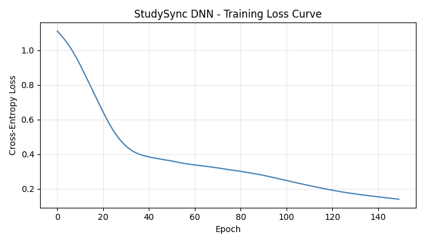
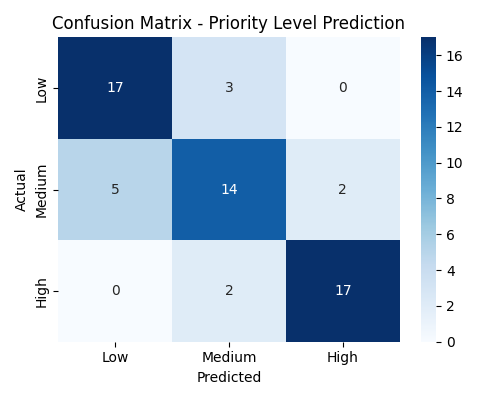

# StudySync

**A personalized study planner that uses a PyTorch neural network to predict subject priorities and turns them into a daily study plan.**

[](https://studysync-bishaleyyy.streamlit.app/)


StudySync was built as a BSc. CSIT Neural Networks project. A student enters a few details for each subject (marks, attendance, difficulty and so on). A small Deep Neural Network (DNN) predicts whether the subject needs **Low**, **Medium** or **High** priority, and a simple rule-based planner splits the student's available study hours accordingly.

## Table of Contents

- [Live Demo](#live-demo)
- [Key Features](#key-features)
- [How StudySync Works](#how-studysync-works)
- [Model and Architecture](#model-and-architecture)
- [Dataset and Training](#dataset-and-training)
- [Evaluation and Limitations](#evaluation-and-limitations)
- [Technology Stack](#technology-stack)
- [Project Structure](#project-structure)
- [Getting Started](#getting-started)
- [Future Improvements](#future-improvements)
- [Contributing](#contributing)

## Live Demo

**[studysync-bishaleyyy.streamlit.app](https://studysync-bishaleyyy.streamlit.app/)**

The app is hosted on Streamlit Community Cloud's free tier. If it has not been used for a while it may be asleep. Click **Wake up** and wait a few seconds.

<!--
App screenshots (add the image files first, then remove this comment markup):


-->

## Key Features

- Enter any number of subjects, each with its own marks, attendance, assignment score, difficulty and days left before the exam
- A DNN predicts a **Low / Medium / High** priority for every subject
- Shows the model's **confidence** (softmax probability) for each prediction
- Generates a **personalized study plan** that divides your available hours by priority
- Displays the plan as cards, a bar chart and a table
- Loads the trained model once and **never retrains** while the app is in use
- Dark-themed interface built with Streamlit

## How StudySync Works

```
Subject details  →  Preprocessing  →  DNN priority prediction  →  Rule-based planner  →  Study plan
```

1. **Input.** For each subject the student provides six values (see the table below).
2. **Preprocessing.** Difficulty is encoded as a number, and all features are standardized using the mean and standard deviation computed from the training data only.
3. **Prediction.** The DNN outputs a score for each priority class, and the highest-scoring class is the predicted priority.
4. **Planning.** `planner.py` (not a neural network) gives each priority a weight and splits the total hours in proportion: **High = 3, Medium = 2, Low = 1**.

Worked example of the planner rule (an illustration of the formula, not a model output): with 5 hours and one subject each of High, Medium and Low priority, the total weight is 6, so the hours are 5 × 3/6 = 2.5, 5 × 2/6 ≈ 1.67 and 5 × 1/6 ≈ 0.83.

In the app, the **Study hours available today** slider (1–6) is used both as the `Study_Hours_Available` input for every subject and as the total hours the planner divides.

### Input features

| Feature | Meaning | Range in training data |
|---|---|---|
| `Study_Hours_Available` | Study hours available per day | 1–6 |
| `Previous_Marks` | Marks in the subject (out of 100) | 20–99 |
| `Attendance` | Attendance percentage | 40–99 |
| `Assignment_Score` | Assignment score percentage | 0–99 |
| `Subject_Difficulty` | Low / Medium / High (encoded 0 / 1 / 2) | 3 levels |
| `Days_Left` | Days left before the exam | 1–29 |

The app's sliders are limited to these ranges so the model only receives values similar to what it saw during training.

## Model and Architecture

```
Input (6) → Linear(6, 16) → ReLU → Linear(16, 8) → ReLU → Linear(8, 3)
```

- **Output classes:** Low (0), Medium (1), High (2)
- The final layer returns raw scores (logits). There is no Softmax layer in the model because `nn.CrossEntropyLoss` applies it internally during training. The app applies softmax only to display the confidence value.
- **Loss:** Cross-entropy
- **Optimizer:** Adam, learning rate 0.01
- **Training:** 150 epochs, full-batch (all 240 training samples in every update)

## Dataset and Training

> **The dataset is synthetic.** It is not real student data. It was generated for academic demonstration because real marks and attendance records are private and hard to collect.

`create_dataset.py` generates 300 samples with a fixed random seed. Each sample gets a hand-designed "need score" that follows common-sense study planning (low marks, low attendance, low assignment score, high difficulty and few days left all mean more attention is needed), plus random noise:

| Component | Weight |
|---|---|
| Low previous marks | 0.30 |
| Low attendance | 0.20 |
| High subject difficulty | 0.20 |
| Low assignment score | 0.15 |
| Few days left | 0.15 |

Random noise (normal, standard deviation 0.05) is added, the score is clipped to 0–1, and it is then cut into three equal-sized groups (Low, Medium, High) using quantiles. This means the three classes are balanced by construction.

`Study_Hours_Available` is generated randomly and is **not** part of the need-score formula, so it does not influence the label in the training data.

**Training pipeline (`preprocessing.py`, `train.py`):**

1. Load `data/study_data.csv` and encode the text columns as numbers.
2. Shuffle and split 80 / 20 into 240 training and 60 test samples (fixed seed).
3. Standardize features using the **training set's** mean and standard deviation, then apply the same values to the test set and to new inputs in the app.
4. Train the DNN, evaluate on the test set, and save the weights (`model/studysync_model.pth`) and scaling values (`model/scaler_mean.npy`, `model/scaler_std.npy`).

## Evaluation and Limitations

### Measured results

On the 60-sample held-out test set, the saved model reaches **80.0% accuracy** (48 of 60 correct).

Confusion matrix (rows are the actual class, columns are the predicted class):

| Actual \ Predicted | Low | Medium | High |
|---|---|---|---|
| **Low** | 17 | 3 | 0 |
| **Medium** | 5 | 14 | 2 |
| **High** | 0 | 2 | 17 |

Per-class values computed from the matrix above:

| Class | Precision | Recall |
|---|---|---|
| Low | 77.3% (17/22) | 85.0% (17/20) |
| Medium | 73.7% (14/19) | 66.7% (14/21) |
| High | 89.5% (17/19) | 89.5% (17/19) |

| Training loss | Confusion matrix |
|---|---|
|  |  |

`train.py` does not set a PyTorch random seed, so retraining can give slightly different numbers.

### Limitations

- **Synthetic labels.** The priorities come from a formula, so the network is effectively learning to recover that noisy rule. The accuracy shows the model can do this. It says nothing about how well it would predict real student needs.
- **Small test set.** 60 samples is a small evaluation set, and a single train/test split with no cross-validation or hyperparameter tuning was used.
- **Relative priority.** Because classes are cut by quantiles, "High" means the top third of the synthetic need scores, not an absolute level of urgency.
- **Independent predictions.** Each subject is predicted on its own. The model does not compare subjects with each other.
- **Simple planner.** Hours are split by fixed weights. The planner does not consider exam dates, subject length or study-session scheduling.

## Technology Stack

| Area | Tools |
|---|---|
| Language | Python |
| Neural network | PyTorch |
| Data and preprocessing | NumPy, Pandas |
| Training plots | Matplotlib, Seaborn |
| Web interface | Streamlit, Altair (charts) |
| Hosting | Streamlit Community Cloud |

## Project Structure

```
StudySync/
├── app.py                  # Streamlit web app
├── create_dataset.py       # generates the synthetic dataset
├── preprocessing.py        # encoding, scaling, train/test split
├── model.py                # DNN architecture (PyTorch)
├── train.py                # trains, evaluates and saves the model
├── planner.py              # rule-based hour allocation
├── main.py                 # command-line demo
├── requirements.txt
├── .streamlit/
│   └── config.toml         # dark theme settings
├── data/
│   └── study_data.csv      # synthetic dataset
├── model/
│   ├── studysync_model.pth # trained weights
│   ├── scaler_mean.npy     # feature scaling values
│   └── scaler_std.npy
└── outputs/
    ├── loss_curve.png
    └── confusion_matrix.png
```

## Getting Started

The trained model is already included in `model/`, so you do **not** need to train anything to run the app.

### Installation

```bash
git clone https://github.com/Bishaleyyy/StudySync.git
cd StudySync
```

Create and activate a virtual environment.

Windows (PowerShell):

```powershell
python -m venv .venv
.venv\Scripts\Activate.ps1
```

If PowerShell blocks the activation script, run this once in the same window and activate again:

```powershell
Set-ExecutionPolicy -Scope Process -ExecutionPolicy RemoteSigned
```

macOS / Linux:

```bash
python3 -m venv .venv
source .venv/bin/activate
```

Install the dependencies:

```bash
pip install -r requirements.txt
```

`requirements.txt` points `pip` at PyTorch's CPU-only package index, which keeps the install smaller and is what the hosted app uses.

### Run the app

```bash
streamlit run app.py
```

The app opens at `http://localhost:8501`.

### Optional: retrain the model

Only needed if you want to regenerate the data or model. This overwrites the files in `data/`, `model/` and `outputs/`.

```bash
python create_dataset.py   # creates data/study_data.csv
python train.py            # trains the DNN and saves the model and plots
```

### Optional: command-line demo

```bash
python main.py
```

Predicts priorities for four example subjects defined inside `main.py`, prints the study plan, and saves a bar chart to `outputs/study_plan.png`.

## Future Improvements

- Train and validate on real, anonymized student data
- Use cross-validation and compare against simple baselines
- Let students save and compare plans over several days
- Add more inputs such as exam weightage or past study-time history

## Contributing

This is a university portfolio project. Suggestions and bug reports are welcome. Please open an issue on the [GitHub repository](https://github.com/Bishaleyyy/StudySync/issues).

---

Built by [Bishal](https://github.com/Bishaleyyy) · BSc. CSIT
